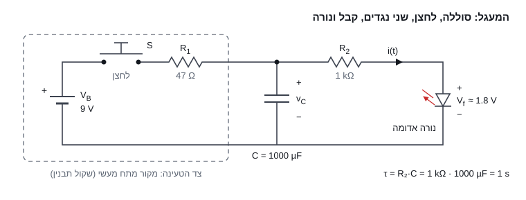

<div dir="rtl">

# נורה שנכבית לאט: דעיכה במעגל RC

פרויקט בונוס לקורס **מבוא להנדסת חשמל** (האוניברסיטה העברית, תשפ"ז).

לוחצים על הלחצן והנורה נדלקת. עוזבים, והנורה לא נכבית מיד אלא **דועכת בהדרגה**, כי הקבל מתפרק דרכה. זמן הדעיכה נקבע על ידי $\tau = R_2 C$, ואפשר לחזות אותו מראש ולמדוד אותו בסטופר.



## רכיבים

| רכיב | ערך | הערה |
| --- | --- | --- |
| סוללה | 9V אחת, עם מחבר וחוטים, $V_B = 9\text{ V}$ | סוללה חדשה נותנת כ־9.5 V, והמתח יורד עם השימוש |
| לחצן $S$ | לחצן רגיל, פתוח במנוחה | סוגר את המעגל כל עוד לוחצים |
| $R_1$ | 47 Ω | מגביל את זרם הטעינה |
| $R_2$ | 1 kΩ | קובע את זמן הדעיכה ואת זרם הנורה |
| $C$ | 1000 µF, 16 V לפחות (וגם 2200 µF להשוואה) | קבל אלקטרוליטי: יש לו קוטביות |
| נורה | LED אדומה, 5 מ"מ | החישובים כאן ל־$V_f \approx 1.8\text{ V}$. לבנה או כחולה (~3 V) נותנת מספרים אחרים |
| מטריצה, חוטים, מולטימטר | | המולטימטר לבדיקות |

## איך זה עובד

**המודל של הנורה (תרגול 3).** כשהנורה דולקת, המתח עליה כמעט לא משתנה עם הזרם (החלק התלול של האופיין). לכן מחליפים אותה במקור מתח קבוע $V_f \approx 1.8\text{ V}$: זה המודל הליניארי למקוטעין של דיודה.

**לחצן לחוץ: טעינה (תרגולים 1, 2).** הסוללה עם $R_1$ היא מקור מתח מעשי. במצב יציב לא זורם זרם לקבל, ולכן $R_1$, $R_2$ והנורה בטור. לפי KVL:

$$i = \frac{V_B - V_f}{R_1 + R_2} = \frac{9 - 1.8}{1047} \approx 6.9\text{ mA}, \qquad v_0 = V_f + i R_2 \approx 8.7\text{ V}$$

הקבל רואה את שקול התבנין של שאר המעגל, $R_{th} = R_1 \parallel R_2 \approx 45\ \Omega$, ולכן הוא נטען תוך כ־0.2 שניות. הטעינה מהירה כי $R_1 \ll R_2$.

**לחצן משוחרר: פריקה (תרגול 4).** הסוללה מנותקת, והקבל מתפרק דרך $R_2$ והנורה. KCL בצומת של הקבל:

$$C\frac{dv_C}{dt} = -\frac{v_C - V_f}{R_2} \quad\Longrightarrow\quad v_C(t) - V_f = (v_0 - V_f)\,e^{-t/\tau}, \qquad \tau = R_2 C = 1\text{ s}$$

זה מעגל מסדר ראשון: $v_C$ לא שואף ל־0 אלא ל־$V_f$, והזרם בנורה דועך אקספוננציאלית:

$$i(t) = \frac{v_0 - V_f}{R_2}\,e^{-t/\tau} \approx 6.9\text{ mA}\cdot e^{-t/1\text{ s}}$$

**החיזוי.** נורה אדומה נראית כבויה בערך ב־0.5 mA. הזמן עד אז:

$$t_{off} = \tau \ln\frac{i_0}{0.5\text{ mA}} = 1\text{ s}\cdot\ln 14 \approx 2.6\text{ s}$$

עם קבל של 2200 µF: $\tau = 2.2\text{ s}$ ו־$t_{off} \approx 5.8\text{ s}$, כלומר פי 2.2. היחס הזה לא תלוי בהגדרה של "כבויה", ולכן הוא הבדיקה הכי אמינה.

**מגבלת המודל.** בזרמים נמוכים המתח על הנורה יורד קצת מתחת ל־1.8 V (האופיין האקספוננציאלי מתרגול 3), ולכן הדעיכה האמיתית ארוכה מעט מהחיזוי. גם לקבלים אלקטרוליטיים יש סטייה של עד ±20% מהערך הרשום.

## הרכבה על מטריצה

1. **הסוללה:** מחבר ה־9V, חוט אדום לפס ה־+, שחור לפס ה־−. לחבר את הסוללה רק בסוף.
2. **הלחצן:** להרכיב אותו מעל התעלה שבאמצע המטריצה. בלחצן עם 4 רגליים, כל שתי רגליים מחוברות פנימית, אז כדאי לחבר שתי רגליים **אלכסוניות**: אחת לפס ה־+, השנייה לשורה A. לבדוק עם מולטימטר שיש קצר רק כשלוחצים.
3. **$R_1$ (47 Ω):** משורה A לשורה B.
4. **הקבל:** הרגל הארוכה (+) לשורה B, הרגל בצד הפס המסומן (−) לפס ה־−. **הקוטביות חשובה.**
5. **$R_2$ (1 kΩ):** משורה B לשורה C.
6. **הנורה:** הרגל הארוכה לשורה C, הקצרה לפס ה־−.

**בדיקות עם מולטימטר (לחצן לחוץ):** המתח על הקבל צריך להיות בערך 8.7 V, ועל הנורה בערך 1.8–2.0 V. אם זה מתאים, גם המודל מתאים.

## חישוב עם הערכים שלכם

אם מדדתם מתח סוללה אחר, או שיש לכם רכיבים אחרים:

</div>

```bash
python3 calc.py                     # the values above
python3 calc.py --VB 5.9            # your measured battery voltage
python3 calc.py --C 2200e-6         # the bigger capacitor
```

<div dir="rtl">

## הצגה בכיתה

עד 4 דקות, כולל ההסבר. התסריט עם החלוקה לזמנים: [docs/PRESENTATION.md](docs/PRESENTATION.md). המצגת (4 שקפים, עם התסריט בהערות הדובר): [docs/presentation.pptx](docs/presentation.pptx).

## קבצים

| קובץ | תפקיד |
| --- | --- |
| `README.md` | המדריך הזה |
| `docs/PRESENTATION.md` | תסריט ההצגה לארבע דקות |
| `docs/presentation.pptx` | המצגת (נבנית עם `docs/slides-src/build_deck.js`) |
| `docs/img/rc_circuit.svg` | השרטוט החשמלי (המקור: `docs/figures-src/rc_circuit.jsx`) |
| `calc.py` | אותם חישובים כמו כאן, עם הערכים שלכם (ספרייה סטנדרטית בלבד) |

</div>
