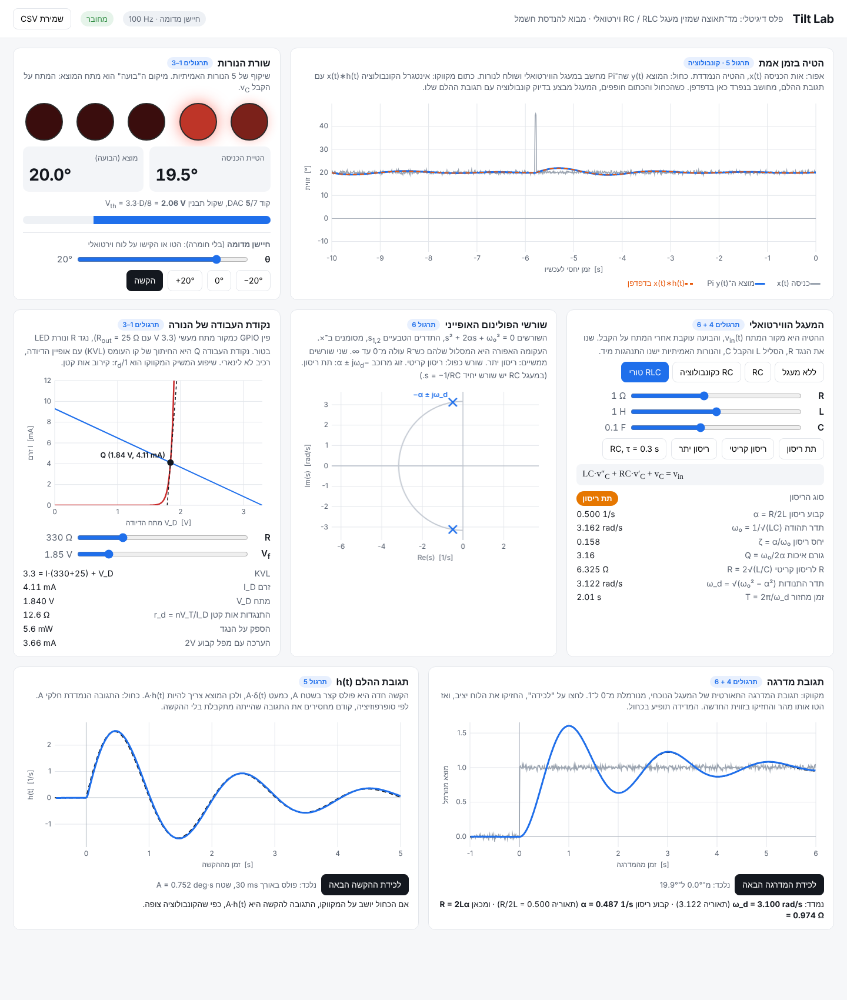
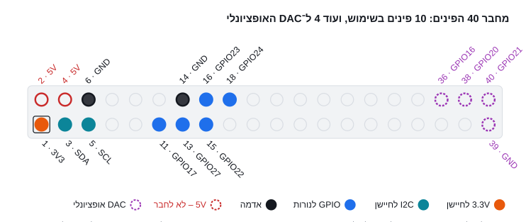
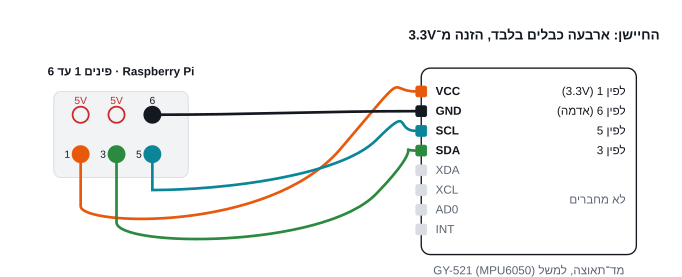
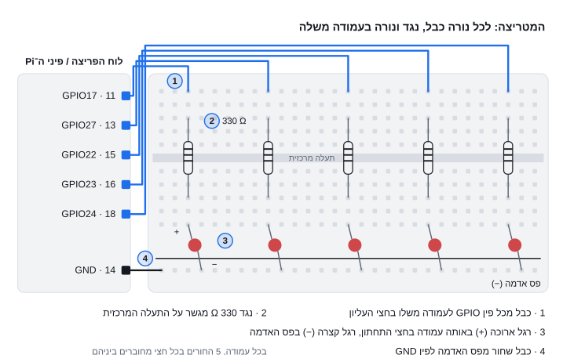
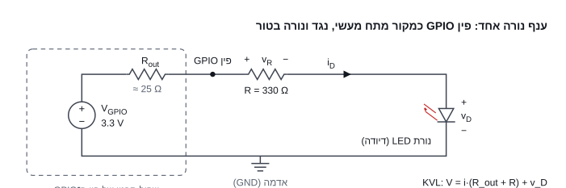
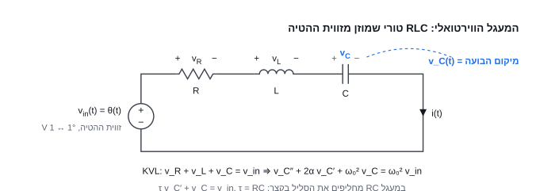
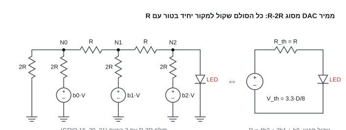

<div dir="rtl">

# Tilt Lab: פלס דיגיטלי עם מעגל RC / RLC וירטואלי

פרויקט בונוס לקורס **מבוא להנדסת חשמל** (האוניברסיטה העברית, תשפ"ז). מד־תאוצה על Raspberry Pi מודד את זווית ההטיה, 5 נורות LED מציגות "בועה", והבועה עוברת דרך מעגל וירטואלי (RC, RC כקונבולוציה, או RLC טורי) שאפשר לשנות בזמן אמת. לוח בקרה בעברית, שה־Pi מגיש לדפדפן במחשב, מציג את כל הגרפים שקשורים לחומר הקורס.

ההרכבה הבסיסית לוקחת כחצי שעה: מד־תאוצה (4 כבלים), 5 נורות ו־5 נגדים של 330 Ω.



## מה מכל תרגול נמצא בפרויקט

| תרגול | נושא | איפה בפרויקט |
| --- | --- | --- |
| 1 | KCL/KVL, נגד, סליל, קבל, הספק | חישוב נגד הנורה (`predict.py`) |
| 2 | מחלק מתח, מתחי צמתים, שקול תבנין, מקור מתח מעשי | פין GPIO כמקור מעשי; DAC מסוג R-2R (אופציונלי) |
| 3 | רכיב לא לינארי, קירוב אות קטן | קו עומס, נקודת עבודה ו־r_d של הנורה |
| 4 | צורות גל, מעגלים מסדר ראשון | מעגל RC ותגובת מדרגה |
| 5 | מערכת LTI, תגובת הלם, קונבולוציה | מצב `conv`, חישוב x∗h בדפדפן, הקשה כהלם |
| 6 | מעגלים מסדר שני, ריסון | מעגל RLC, שורשי הפולינום האופייני |

## הרכבה

| | |
| --- | --- |
|  |  |



1. **חיישן:** VCC לפין 1 (3.3V), GND לפין 6, SDA לפין 3, SCL לפין 5.
2. **נורות:** לכל נורה כבל מ־GPIO 17, 27, 22, 23, 24 לעמודה בחצי העליון, נגד 330 Ω מעל התעלה, רגל ארוכה באותה עמודה ורגל קצרה בפס האדמה.
3. **אדמה:** כבל מפס האדמה לפין 14.

## שרטוטים חשמליים





## התקנה והרצה

על ה־Pi, פעם אחת:

</div>

```bash
sudo raspi-config nonint do_i2c 0 && sudo reboot
sudo apt install -y python3-smbus i2c-tools
i2cdetect -y 1                          # 68 / 53 / 18 / 1c
```

<div dir="rtl">

הרצה:

</div>

```bash
python3 tiltlab.py --zero --dashboard   # http://raspberrypi.local:8000 on the Mac
python3 tiltlab.py --sim --dashboard    # no hardware: http://localhost:8000
python3 tiltlab.py --mode rlc --R 1 --L 1 --C 0.1 --log run.csv
python3 analyze.py run.csv              # run.png + run_report.txt
python3 predict.py                      # LED / load-line / DAC numbers
```

<div dir="rtl">

## יום ההדגמה

ה־Pi יוצר רשת Wi-Fi משלו (`TiltLab`, כתובת `http://10.42.0.1:8000`), או מתחבר ל־Mac בכבל USB-C, כך שההדגמה לא תלויה ברשת של האוניברסיטה. הגדרה חד־פעמית: `sudo bash pi/setup_pi.sh`. כל הפרטים ב־[docs/DEMO_DAY.md](docs/DEMO_DAY.md).

## קבצים

| קובץ | תפקיד |
| --- | --- |
| `tiltlab.py` | הלולאה הראשית (100 Hz): חיישן ← מעגל וירטואלי ← נורות, לוח בקרה, CSV |
| `accel.py` | זיהוי אוטומטי של MPU6050 / ADXL345 / LIS3DH / MMA8452, וחיישן מדומה |
| `filters.py` | RC (פתרון מדויק), RC כקונבולוציה, RLC טורי (RK4) |
| `dashboard_server.py`, `dashboard.html` | לוח הבקרה (ספרייה סטנדרטית בלבד, בעברית) |
| `predict.py` | חישובי המעגל שבמדריך (numpy) |
| `analyze.py` | גרף מדידה מול תאוריה (numpy, matplotlib) |
| `dac_test.py` | בדיקת ה־DAC האופציונלי |
| `pi/` | הגדרת הרשת וההפעלה האוטומטית ל־Pi (`setup_pi.sh`, `tiltlab-net.sh`, `tiltlab.service`) |
| `docs/` | האיורים והשרטוטים, ומקורות ה־JSX שלהם (`docs/figures-src`, נבנים עם `render.mjs`) |

המדריך המלא בעברית, עם הנגזרות, הטבלאות ותסריט ההדגמה, נמצא במסמך הנלווה לפרויקט.

</div>
